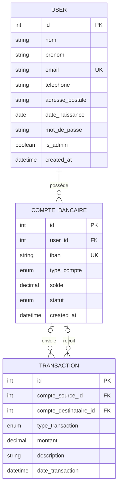

# Diagramme de la base de données KampusBank

Base `banque_db`, créée par `database.sql`. GitHub affiche le diagramme ci-dessous directement.

## MCD (modèle conceptuel)

### Cardinalités

| Relation | Côté A | Côté B | Sens |
|---|---|---|---|
| USER possède COMPTE_BANCAIRE | 0,N | 1,1 | Un client a plusieurs comptes, un compte a un seul propriétaire |
| COMPTE_BANCAIRE envoie TRANSACTION | 0,N | 0,1 | Un retrait ou un virement part d'un compte, un dépôt n'a pas de source |
| COMPTE_BANCAIRE reçoit TRANSACTION | 0,N | 0,1 | Un dépôt ou un virement arrive sur un compte, un retrait n'a pas de destinataire |

Un virement relie deux comptes : `compte_source_id` et `compte_destinataire_id` sont remplis.

## MLD (modèle logique)

**users** (<u>id</u>, nom, prenom, email, telephone, adresse_postale, date_naissance, mot_de_passe, is_admin, created_at)

- `email` : unique

**comptes_bancaires** (<u>id</u>, #user_id, iban, type_compte, solde, statut, created_at)

- `user_id` → `users.id`, `ON DELETE CASCADE`
- `iban` : unique, format `FR76-YBNK-XXXX-XXXX-XXXX-XXXX-XXX`
- `type_compte` : `courant`, `livret A` ou `PEL`
- `statut` : `actif` (par défaut) ou `bloqué`
- `solde` : 0.00 par défaut

**transactions** (<u>id</u>, #compte_source_id, #compte_destinataire_id, type_transaction, montant, description, date_transaction)

- `compte_source_id` → `comptes_bancaires.id`, `ON DELETE SET NULL`
- `compte_destinataire_id` → `comptes_bancaires.id`, `ON DELETE SET NULL`
- `type_transaction` : `depot`, `retrait`, `virement_emis` ou `virement_recu`
- `montant` : strictement positif (contrainte `CHECK`)
- `description` : peut être vide

Les colonnes `#` sont des clés étrangères, la colonne soulignée est la clé primaire.
